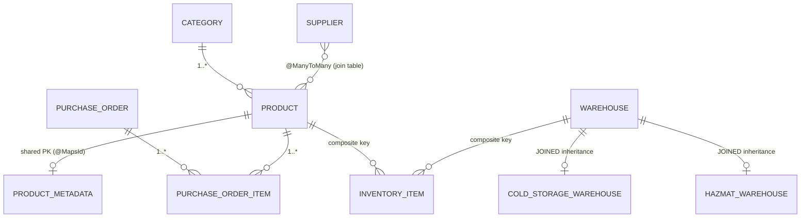

# Spring Data Playground — Inventory Manager

A runnable, test-driven showcase of **Hibernate 6.x** and **Spring Data JPA**, built as a small
inventory-management domain. Every major ORM feature — entity mapping, associations, inheritance,
querying, transactions, locking, caching — is implemented in real code and **proven by an integration
test** you can run and step through.

> 📖 **Start here:** the companion [**Hibernate & JPA Guide**](HIBERNATE_JPA_GUIDE.md) explains every
> concept in depth, with diagrams, the SQL Hibernate generates, and links into this codebase.

## Tech Stack

| | |
| :--- | :--- |
| Language | Java 21 |
| Framework | Spring Boot 4.1 (`spring-boot-starter-data-jpa`, `spring-boot-starter-web`) |
| ORM | Hibernate 6.x via Spring Data JPA |
| Database | H2 in-memory (schema auto-generated with `ddl-auto: create-drop`) |
| Build | Maven |
| Testing | JUnit 5, AssertJ, `@SpringBootTest` |

No external database or setup required — the H2 schema is rebuilt from the entity mappings on every run.

## Getting Started

```bash
# Run the full test suite (the primary way to explore this project)
mvn test

# Run a single feature's tests
mvn test -Dtest=LockingIntegrationTest

# Boot the application (starts an empty web app with the JPA layer wired up)
mvn spring-boot:run
```

`show-sql`, `format_sql`, and `use_sql_comments` are enabled in
[application.yml](src/main/resources/application.yml) — run any test and read the exact SQL Hibernate
emits in the console. That log is half the value of this playground.

## The Domain



Each relationship exists to demonstrate a specific mapping technique — nothing here is accidental.

## What's Demonstrated

| Feature | Where | Guide section |
| :--- | :--- | :--- |
| Column mapping, `@Enumerated(STRING)`, `BigDecimal` precision | [`Product`](src/main/java/com/example/inventory/domain/Product.java) | [§2.1](HIBERNATE_JPA_GUIDE.md#21-basic-annotations--column-mapping) |
| Soft delete (`@SQLDelete` + `@SQLRestriction`) | [`Product`](src/main/java/com/example/inventory/domain/Product.java) | [§2.5](HIBERNATE_JPA_GUIDE.md#25-soft-deletion-sqldelete--sqlrestriction) |
| Auditing (`@CreatedDate`, `@CreatedBy`, `AuditorAware`) | [`AuditableEntity`](src/main/java/com/example/inventory/domain/AuditableEntity.java), [`JpaAuditingConfig`](src/main/java/com/example/inventory/config/JpaAuditingConfig.java) | [§2.6](HIBERNATE_JPA_GUIDE.md#26-auditing-who-changed-what-when) |
| Embeddables (`@Embeddable`, `@AttributeOverrides`) | [`Address`](src/main/java/com/example/inventory/domain/Address.java), [`Supplier`](src/main/java/com/example/inventory/domain/Supplier.java) | [§2.3](HIBERNATE_JPA_GUIDE.md#23-embeddables-embeddable--embedded--attributeoverrides) |
| Entity lifecycle (transient → managed → detached → merge) | [`InventoryService`](src/main/java/com/example/inventory/service/InventoryService.java) | [§3](HIBERNATE_JPA_GUIDE.md#3-the-entity-lifecycle--the-persistence-context) |
| 1:1 with shared primary key (`@MapsId`), `@Lob` | [`ProductMetadata`](src/main/java/com/example/inventory/domain/ProductMetadata.java) | [§4.2](HIBERNATE_JPA_GUIDE.md#42-one-to-one-with-a-shared-primary-key-mapsid) |
| Bidirectional 1:N, cascade, `orphanRemoval`, sync helpers | [`Category`](src/main/java/com/example/inventory/domain/Category.java) | [§4.3](HIBERNATE_JPA_GUIDE.md#43-one-to-many--many-to-one-bidirectional) |
| M:N via join table, and M:N with a payload entity | [`Supplier`](src/main/java/com/example/inventory/domain/Supplier.java), [`PurchaseOrderItem`](src/main/java/com/example/inventory/domain/PurchaseOrderItem.java) | [§4.4](HIBERNATE_JPA_GUIDE.md#44-many-to-many--two-ways) |
| Composite primary key (`@EmbeddedId` + `@MapsId`) | [`InventoryItem`](src/main/java/com/example/inventory/domain/InventoryItem.java), [`InventoryItemId`](src/main/java/com/example/inventory/domain/InventoryItemId.java) | [§4.5](HIBERNATE_JPA_GUIDE.md#45-composite-primary-keys-embeddedid--mapsid) |
| JOINED inheritance with polymorphic queries | [`Warehouse`](src/main/java/com/example/inventory/domain/Warehouse.java) + subclasses | [§5](HIBERNATE_JPA_GUIDE.md#5-inheritance-mapping-strategies) |
| Derived queries, pagination, JPQL, native SQL, `@Modifying`, `@EntityGraph` (N+1), 3 projection styles | [`ProductRepository`](src/main/java/com/example/inventory/repository/ProductRepository.java) | [§6](HIBERNATE_JPA_GUIDE.md#6-spring-data-jpa-repositories--querying) |
| Dynamic queries with `Specification` | [`PurchaseOrderSpecifications`](src/main/java/com/example/inventory/repository/PurchaseOrderSpecifications.java) | [§6.7](HIBERNATE_JPA_GUIDE.md#67-dynamic-queries-with-the-specification-api) |
| Propagation (`REQUIRED` vs `REQUIRES_NEW`) & rollback rules | [`OrderProcessingService`](src/main/java/com/example/inventory/service/OrderProcessingService.java), [`AuditLogService`](src/main/java/com/example/inventory/service/AuditLogService.java) | [§7](HIBERNATE_JPA_GUIDE.md#7-transactions--propagation) |
| Optimistic (`@Version`) & pessimistic (`@Lock`) locking | [`InventoryService`](src/main/java/com/example/inventory/service/InventoryService.java), [`ProductRepository`](src/main/java/com/example/inventory/repository/ProductRepository.java) | [§8](HIBERNATE_JPA_GUIDE.md#8-concurrency-optimistic--pessimistic-locking) |

## The Tests Are the Documentation

| Test class | Proves |
| :--- | :--- |
| [`ProductRepositoryTest`](src/test/java/com/example/inventory/ProductRepositoryTest.java) | All 10 querying techniques: derived queries, pagination/sorting, JPQL, native SQL, bulk `@Modifying` with L1-cache clearing, interface/record/dynamic projections, `@EntityGraph` N+1 resolution |
| [`SoftDeleteAndAuditingTest`](src/test/java/com/example/inventory/SoftDeleteAndAuditingTest.java) | Audit columns are stamped on flush; a "deleted" product vanishes from every JPA query but the row still exists (verified with raw JDBC) |
| [`InheritanceAndCompositeKeyTest`](src/test/java/com/example/inventory/InheritanceAndCompositeKeyTest.java) | Polymorphic queries return correctly-typed subclasses from JOINED tables; lookup by composite key |
| [`TransactionPropagationTest`](src/test/java/com/example/inventory/TransactionPropagationTest.java) | Runtime exceptions roll back, checked exceptions **commit** (unless `rollbackFor`), and a `REQUIRES_NEW` audit record survives its parent's rollback |
| [`LockingIntegrationTest`](src/test/java/com/example/inventory/LockingIntegrationTest.java) | A stale-versioned save fails with `ObjectOptimisticLockingFailureException`; two real threads serialize on a `PESSIMISTIC_WRITE` row lock |

## Project Structure

```
src/
├── main/java/com/example/inventory/
│   ├── config/          # @EnableJpaAuditing + AuditorAware bean
│   ├── domain/          # 13 entities/embeddables — the heart of the project
│   ├── dto/             # Projection targets (interface + record)
│   ├── exception/       # Checked exception for the rollback-rules demo
│   ├── repository/      # Spring Data repositories + Specifications
│   └── service/         # Lifecycle, locking, and transaction-propagation demos
├── main/resources/
│   └── application.yml  # H2 + Hibernate SQL-logging configuration
└── test/java/com/example/inventory/   # 5 integration test suites
```
