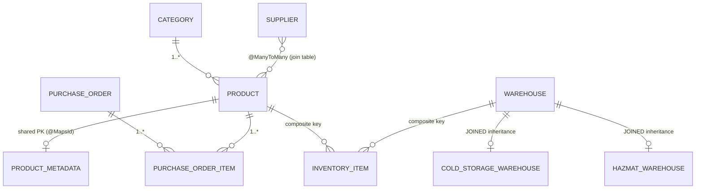
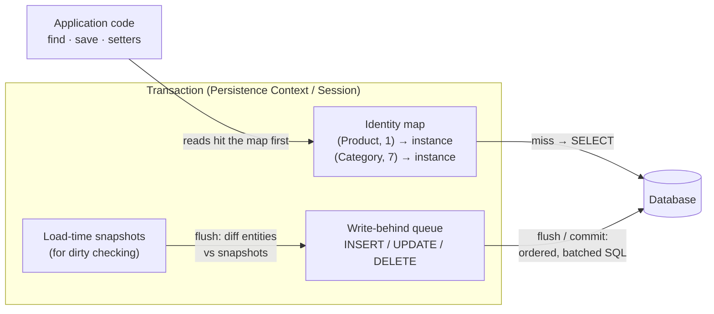
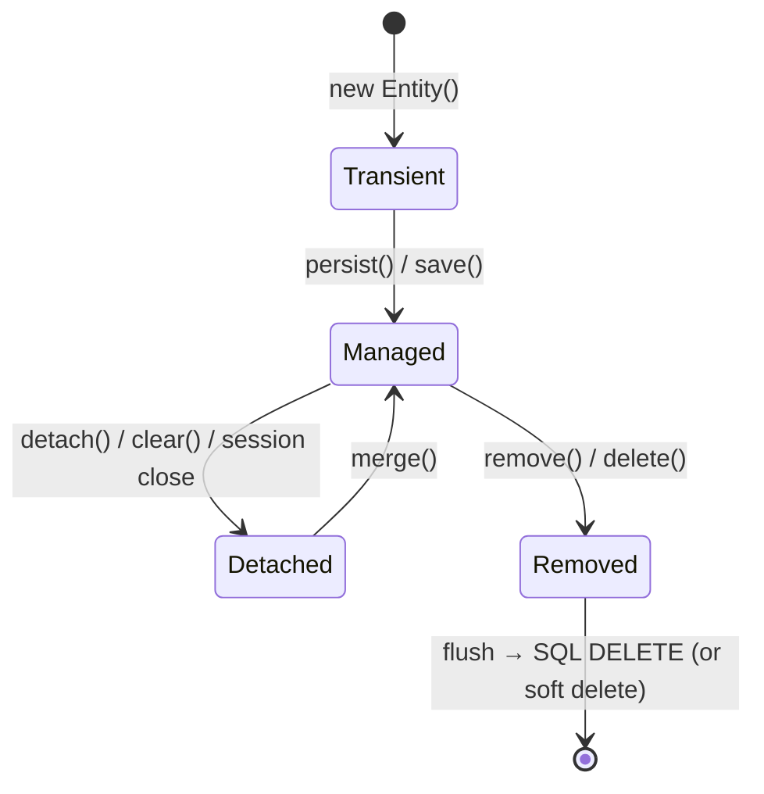
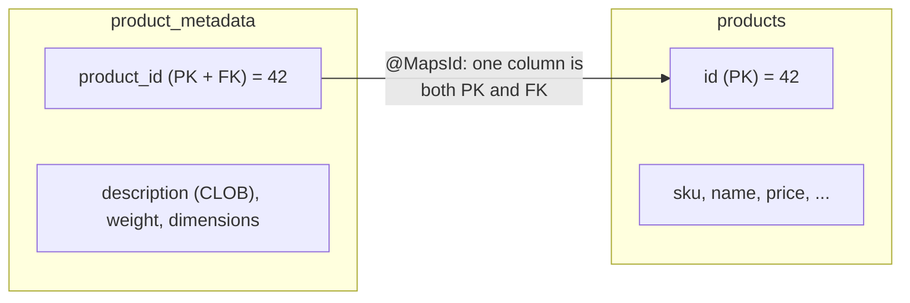
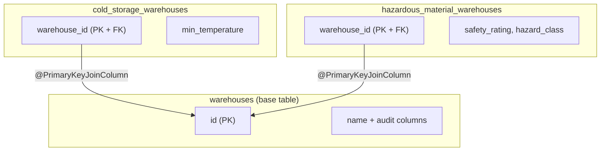
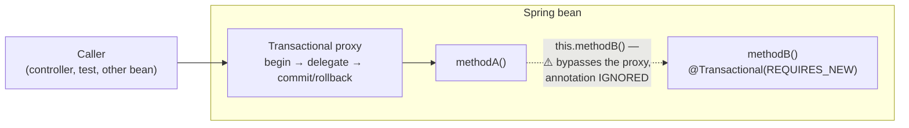
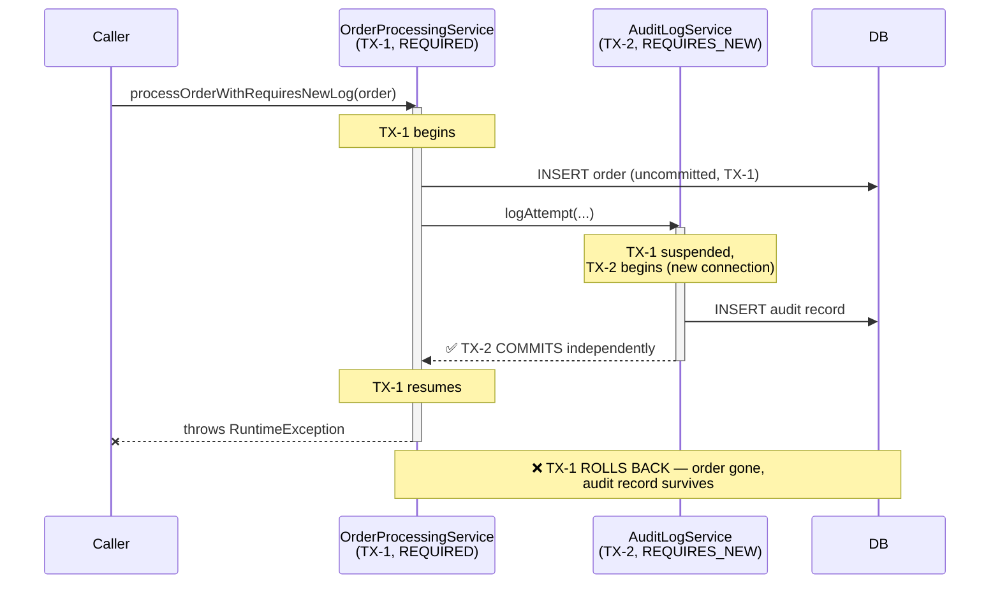
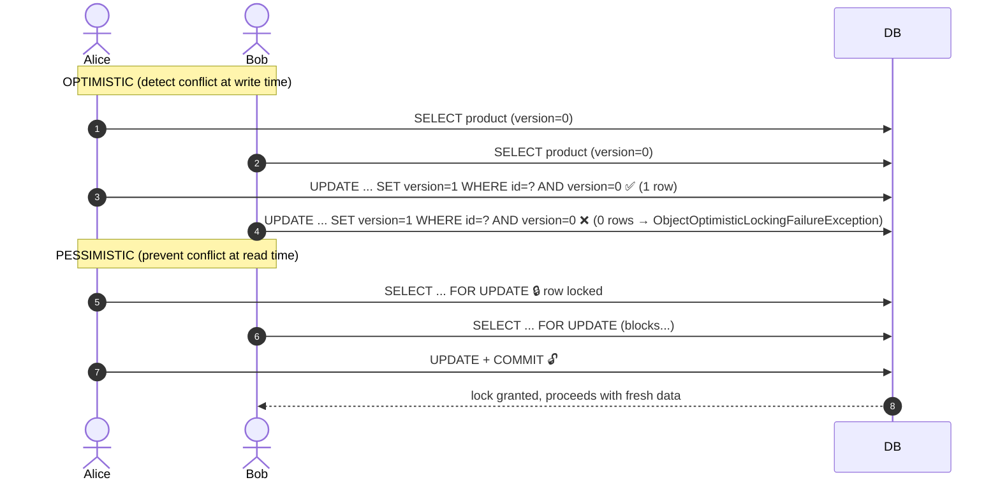
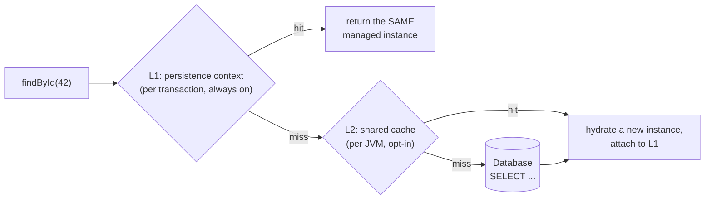

# The Ultimate Guide to Hibernate & Spring Data JPA

## Reference Architecture: Spring Boot 4.1 / Hibernate 6.x / Java 21 — Inventory Manager

This guide is a deep-dive reference for **Hibernate** and **Spring Data JPA**, where every concept is
backed by runnable code in this repository. It is organized so you can read it top-to-bottom as a course,
or jump into a section and follow the file links into the source and the integration test that proves
the behavior.

**The domain**: an inventory management system with products, categories, suppliers, warehouses
(including specialized cold-storage and hazardous-material warehouses), per-warehouse stock levels,
and purchase orders.



### Contents

1. [Project Setup & Configuration](#1-project-setup--configuration)
2. [Entity Mapping Fundamentals](#2-entity-mapping-fundamentals)
3. [The Entity Lifecycle & the Persistence Context](#3-the-entity-lifecycle--the-persistence-context)
4. [Associations & Relationship Design](#4-associations--relationship-design)
5. [Inheritance Mapping Strategies](#5-inheritance-mapping-strategies)
6. [Spring Data JPA Repositories & Querying](#6-spring-data-jpa-repositories--querying)
7. [Transactions & Propagation](#7-transactions--propagation)
8. [Concurrency: Optimistic & Pessimistic Locking](#8-concurrency-optimistic--pessimistic-locking)
9. [Performance & Caching](#9-performance--caching)
10. [Pitfalls & Best-Practices Checklist](#10-pitfalls--best-practices-checklist)
11. [Feature-to-Code Map](#appendix-feature-to-code-map)

---

## 1. Project Setup & Configuration

### 1.1 Dependencies ([pom.xml](pom.xml))

The project needs surprisingly little:

| Dependency | Purpose |
| :--- | :--- |
| `spring-boot-starter-data-jpa` | Pulls in Spring Data JPA, Hibernate ORM, Spring's transaction management, and HikariCP connection pooling |
| `com.h2database:h2` | In-memory database — schema is rebuilt on every run, ideal for a playground |
| `lombok` | Generates getters/setters/constructors; keeps the entity classes focused on mapping annotations |
| `spring-boot-starter-test` | JUnit 5, AssertJ, and Spring's `@SpringBootTest` support |

Run everything with:

```bash
mvn test
```

### 1.2 JPA Configuration ([application.yml](src/main/resources/application.yml))

```yaml
spring:
  datasource:
    url: jdbc:h2:mem:inventorydb;DB_CLOSE_DELAY=-1;DB_CLOSE_ON_EXIT=FALSE
  jpa:
    hibernate:
      ddl-auto: create-drop        # Hibernate generates the schema from the entity mappings
    show-sql: true                 # Log every SQL statement
    properties:
      hibernate:
        format_sql: true           # Pretty-print the SQL
        highlight_sql: true        # ANSI-color the SQL in the console
        use_sql_comments: true     # Prefix each statement with the originating HQL/reason
    open-in-view: false            # See below — always disable this
```

Three settings deserve special attention:

- **`ddl-auto: create-drop`** — Hibernate derives `CREATE TABLE` statements from the annotations at
  startup and drops them at shutdown. This is what makes the playground self-contained. In production
  you would use `validate` (fail fast if the schema drifts from the mappings) and manage schema changes
  with Flyway or Liquibase. Never use `update` in production: it only ever *adds*, never removes or
  alters safely.
- **`open-in-view: false`** — By default Spring Boot keeps the Hibernate `Session` open for the entire
  HTTP request ("Open Session In View"), which lets views lazily load associations *after* the
  transaction ended. That sounds convenient but hides N+1 problems, holds database connections across
  view rendering, and makes transactional boundaries fuzzy. Disabling it forces you to fetch everything
  you need *inside* the service/transaction layer — which is exactly what the fetch-strategy techniques
  in [§6.6](#66-the-n1-query-problem) are for.
- **`show-sql` + `format_sql` + `use_sql_comments`** — the single most valuable learning tool in this
  repo. Run any test and read the SQL Hibernate actually emits; most of this guide's "generated SQL"
  snippets come straight from that output.

### 1.3 Test Setup Pattern

Most test classes are annotated:

```java
@SpringBootTest
@Transactional
class ProductRepositoryTest { ... }
```

`@Transactional` on a test class wraps **each test method in a transaction that is rolled back at the
end**, so tests can't pollute each other. Two test classes deliberately *omit* it:

- [LockingIntegrationTest.java](src/test/java/com/example/inventory/LockingIntegrationTest.java) —
  locking requires **two genuinely concurrent transactions**; wrapping the test in one big transaction
  would make that impossible.
- [TransactionPropagationTest.java](src/test/java/com/example/inventory/TransactionPropagationTest.java) —
  the whole point is to observe *real* commits and rollbacks; a test-managed outer transaction would
  swallow them (and `REQUIRES_NEW` inside a rolled-back test transaction gets confusing fast).

Both instead clean up with `deleteAllInBatch()` in `@BeforeEach`.

---

## 2. Entity Mapping Fundamentals

### 2.1 Basic Annotations & Column Mapping

[Product.java](src/main/java/com/example/inventory/domain/Product.java) is the canonical entity in this
project and exercises nearly every basic mapping feature:

```java
@Entity
@Table(name = "products")
@SQLDelete(sql = "UPDATE products SET deleted = true WHERE id = ? AND version = ?")
@SQLRestriction("deleted = false")
public class Product extends AuditableEntity {

    @Id
    @GeneratedValue(strategy = GenerationType.IDENTITY)
    private Long id;

    @Column(nullable = false, unique = true, length = 50)
    private String sku;

    @Column(nullable = false, precision = 10, scale = 2)
    private BigDecimal price;

    @Enumerated(EnumType.STRING)
    @Column(nullable = false, length = 20)
    private ProductStatus status;

    @Version
    private Integer version;

    @Column(nullable = false)
    private boolean deleted = false;
    // ... associations covered in §4
}
```

Annotation by annotation:

- **`@Entity`** marks the class as managed by JPA. Requirements: a no-arg constructor (Lombok or
  implicit), a field or property marked `@Id`, and the class must not be `final` (Hibernate subclasses
  it at runtime to build lazy proxies).
- **`@Table(name = "products")`** decouples the Java class name from the table name. Also the place for
  `indexes = ...` and `uniqueConstraints = ...` when a constraint spans multiple columns.
- **`@Column`** controls DDL and runtime behavior: `nullable`/`unique` become constraints,
  `length` sizes VARCHAR columns, and `precision`/`scale` are **essential for `BigDecimal` money
  columns** — `precision = 10, scale = 2` means "10 significant digits, 2 after the decimal point"
  (`DECIMAL(10,2)`). Without them you get a database default that may silently truncate.
- **`@Enumerated(EnumType.STRING)`** stores the enum's *name* (`'ACTIVE'`) rather than its *ordinal*
  (`0`). Always use `STRING`: with the default `ORDINAL`, inserting a new constant in the middle of
  [ProductStatus](src/main/java/com/example/inventory/domain/ProductStatus.java) silently corrupts
  every existing row's meaning.
- **`@Version`** enables optimistic locking — covered in depth in [§8.1](#81-optimistic-locking-version).

### 2.2 Primary Key Generation Strategies

`@GeneratedValue(strategy = ...)` picks how IDs are produced:

| Strategy | Mechanism | Batch-insert friendly? | Notes |
| :--- | :--- | :--- | :--- |
| `IDENTITY` | Database auto-increment column | **No** — Hibernate must execute each `INSERT` immediately to learn the ID, which disables JDBC insert batching | What this project uses; simplest, matches H2/MySQL idioms |
| `SEQUENCE` | Database sequence, pre-fetched in blocks (`allocationSize`, default 50) | **Yes** — IDs are known before flush | Preferred for PostgreSQL/Oracle and for high write throughput |
| `TABLE` | A dedicated key table emulating a sequence | Yes, but slow (extra row locks) | Legacy portability only; avoid |
| `AUTO` | Hibernate picks based on the dialect | Depends | Fine for prototypes; be explicit in real systems |

A practical consequence of `IDENTITY` visible in this codebase: `repository.save(newEntity)` triggers an
immediate `INSERT` (the ID is needed to place the entity in the persistence context), whereas with
`SEQUENCE` the insert could be deferred to flush time.

### 2.3 Embeddables: `@Embeddable` / `@Embedded` / `@AttributeOverrides`

Value objects that don't deserve their own table are mapped as **embeddables**. Their columns are
inlined into the owning entity's table, but the Java model stays clean and reusable.

[Address.java](src/main/java/com/example/inventory/domain/Address.java):

```java
@Embeddable
public class Address {
    @Column(name = "street_address", length = 150)
    private String street;
    @Column(length = 100)
    private String city;
    @Column(name = "zip_code", length = 20)
    private String zipCode;
    @Column(length = 100)
    private String country;
}
```

[Supplier.java](src/main/java/com/example/inventory/domain/Supplier.java) embeds it and **renames the
columns** with `@AttributeOverrides` — this is how the same embeddable can be reused by many entities
(or even twice in one entity, e.g. `billingAddress` + `shippingAddress`) without column-name collisions:

```java
@Embedded
@AttributeOverrides({
        @AttributeOverride(name = "street",  column = @Column(name = "supplier_street")),
        @AttributeOverride(name = "city",    column = @Column(name = "supplier_city")),
        @AttributeOverride(name = "zipCode", column = @Column(name = "supplier_zip_code")),
        @AttributeOverride(name = "country", column = @Column(name = "supplier_country"))
})
private Address address;
```

Resulting DDL: the `suppliers` table simply gains four `supplier_*` columns. No join, no extra table,
no fetch cost. Embeddables have identity only through their owner — they are classic DDD *value objects*.

The second embeddable in the project,
[InventoryItemId.java](src/main/java/com/example/inventory/domain/InventoryItemId.java), serves as a
composite primary key — see [§4.5](#45-composite-primary-keys-embeddedid--mapsid).

### 2.4 Large Objects: `@Lob`

[ProductMetadata.java](src/main/java/com/example/inventory/domain/ProductMetadata.java) stores a
potentially long description:

```java
@Lob
@Column(columnDefinition = "CLOB")
private String description;
```

`@Lob` on a `String` maps to `CLOB` (character LOB); on `byte[]` it maps to `BLOB`. Large columns like
this are exactly why the 1:1 `ProductMetadata` split exists — see [§4.2](#42-one-to-one-with-a-shared-primary-key-mapsid):
you don't want to drag a CLOB across the wire every time you list products.

### 2.5 Soft Deletion: `@SQLDelete` + `@SQLRestriction`

Business data is rarely truly deleted — regulations, audits, and "undo" all demand history. Soft
deletion keeps the row but flags it invisible. Hibernate 6 makes this a two-annotation pattern
([Product.java](src/main/java/com/example/inventory/domain/Product.java)):

```java
@SQLDelete(sql = "UPDATE products SET deleted = true WHERE id = ? AND version = ?")
@SQLRestriction("deleted = false")
```

- **`@SQLDelete`** replaces the SQL Hibernate would emit for a `DELETE` with your own statement. The
  parameter order matters and must match what Hibernate binds: the **ID first**, and — because `Product`
  is a versioned entity — **the current `version` second**. Keeping the version check means soft
  deletes still participate in optimistic locking: deleting a stale copy of the row fails just like a
  stale update would.
- **`@SQLRestriction`** (the Hibernate 6 replacement for the deprecated `@Where`) appends
  `deleted = false` to **every** SELECT for this entity — `findById`, `findAll`, derived queries, JPQL,
  Criteria, association fetches. The rest of the application never sees a deleted row.

> [!WARNING]
> `@SQLRestriction` is **not** applied to native SQL queries. Note how
> [`findProductsByStatusNative`](src/main/java/com/example/inventory/repository/ProductRepository.java)
> has to spell out `AND deleted = false` by hand. Every native query against a soft-deleted table must
> repeat the filter — a recurring source of production bugs.

The full round-trip is proven in
[SoftDeleteAndAuditingTest.java](src/test/java/com/example/inventory/SoftDeleteAndAuditingTest.java):

```java
productRepository.delete(savedProduct);
productRepository.flush();

// Invisible through JPA...
assertThat(productRepository.findById(id)).isEmpty();

// ...but the row physically still exists (verified with raw JDBC, which bypasses Hibernate):
Boolean dbDeleted = jdbcTemplate.queryForObject(
        "SELECT deleted FROM products WHERE id = ?", Boolean.class, id);
assertThat(dbDeleted).isTrue();
```

Using plain `JdbcTemplate` for the final assertion is deliberate — it is the only way to observe the
table *without* Hibernate's restriction filtering the row out.

### 2.6 Auditing: Who Changed What, When

Spring Data JPA can stamp created/modified metadata automatically. Three pieces cooperate:

**1. A `@MappedSuperclass` base**
([AuditableEntity.java](src/main/java/com/example/inventory/domain/AuditableEntity.java)):

```java
@MappedSuperclass
@EntityListeners(AuditingEntityListener.class)
public abstract class AuditableEntity {

    @CreatedDate
    @Column(name = "created_date", nullable = false, updatable = false)
    private LocalDateTime createdDate;

    @LastModifiedDate
    @Column(name = "last_modified_date")
    private LocalDateTime lastModifiedDate;

    @CreatedBy
    @Column(name = "created_by", updatable = false)
    private String createdBy;

    @LastModifiedBy
    @Column(name = "last_modified_by")
    private String lastModifiedBy;
}
```

`@MappedSuperclass` means: *this class contributes columns to each subclass's table but has no table of
its own and cannot be queried*. `Product`, `Category`, `Supplier`, `Warehouse`, and `PurchaseOrder` all
extend it, so each of their tables carries the four audit columns. Note `updatable = false` on the
"created" pair — even buggy code that mutates `createdDate` can't overwrite the stored value, because
Hibernate excludes the column from `UPDATE` statements.

**2. The listener** — `@EntityListeners(AuditingEntityListener.class)` hooks Spring's auditing into
JPA's `@PrePersist`/`@PreUpdate` lifecycle callbacks. The dates are filled from the clock; the user
fields ask the `AuditorAware` bean.

**3. Activation + the current user**
([JpaAuditingConfig.java](src/main/java/com/example/inventory/config/JpaAuditingConfig.java)):

```java
@Configuration
@EnableJpaAuditing(auditorAwareRef = "auditorProvider")
public class JpaAuditingConfig {
    @Bean
    public AuditorAware<String> auditorProvider() {
        // Demo stub. In a real app, pull the principal from Spring Security:
        // SecurityContextHolder.getContext().getAuthentication().getName()
        return () -> Optional.of("system-user");
    }
}
```

Nothing happens without `@EnableJpaAuditing` — forgetting it (or forgetting the `@EntityListeners`
annotation) is the classic "why are my audit columns null" bug.
[SoftDeleteAndAuditingTest.java](src/test/java/com/example/inventory/SoftDeleteAndAuditingTest.java)
asserts all four fields are populated after a flush.

---

## 3. The Entity Lifecycle & the Persistence Context

### 3.1 The Persistence Context (Session)

Everything Hibernate does revolves around the **persistence context** — the `EntityManager` in JPA
terms, the `Session` in Hibernate terms. It is a per-transaction, in-memory map of
`(entity class, id) → entity instance` that serves three jobs:

1. **Identity map / first-level cache** — loading the same ID twice in one transaction returns the
   *same Java object* without a second `SELECT`.
2. **Dirty checking** — at flush time, Hibernate diffs every managed entity against the snapshot taken
   when it was loaded, and generates `UPDATE` statements for whatever changed. You almost never call
   an explicit "update" method; **mutating a managed entity inside a transaction *is* the update**.
3. **Write-behind queue** — `INSERT`/`UPDATE`/`DELETE` statements are queued and executed at **flush**
   (just before commit, before a query that needs consistent data, or on explicit `flush()`), which
   lets Hibernate order and batch them.



### 3.2 The Four Lifecycle States



| State | In persistence context? | Has DB identity? | Changes tracked? |
| :--- | :--- | :--- | :--- |
| **Transient** | No | No (id null) | No |
| **Managed** | Yes | Yes | **Yes — auto-flushed** |
| **Detached** | No | Yes | No |
| **Removed** | Yes (scheduled for delete) | Until flush | — |

### 3.3 Walking Through the States in Code

[`InventoryService.demonstrateEntityStates`](src/main/java/com/example/inventory/service/InventoryService.java)
performs every transition inside one transaction, using `entityManager.contains(entity)` as the litmus
test for "is this instance managed":

```java
// 1. TRANSIENT — plain Java object, Hibernate knows nothing about it
Product product = new Product();
product.setSku(sku);
entityManager.contains(product);            // false

// 2. MANAGED — save() attaches it; the INSERT fires now (IDENTITY id needed)
product = productRepository.save(product);
entityManager.contains(product);            // true

// Mutating a managed entity — no save() call needed!
// Dirty checking emits the UPDATE automatically at flush/commit.
product.setName(name + " (Updated in Managed State)");

// 3. DETACHED — evicted from the session
entityManager.detach(product);
product.setName("This should never be saved");   // silently ignored — nothing tracks it

// Back to MANAGED via merge(). CRUCIAL: merge returns a NEW managed instance;
// the argument stays detached. Always keep working with the return value.
Product managedProduct = entityManager.merge(product);
managedProduct.setName(name + " (Final)");        // tracked again
```

Key takeaways:

- **`persist` vs `merge`**: `persist` is for transient objects (makes *the passed instance* managed);
  `merge` is for detached ones (copies state onto a managed instance — possibly loading it first — and
  *returns that instance*). Spring Data's `save()` chooses for you: it calls `persist` if the entity is
  new (null id / null version), `merge` otherwise.
- The "This should never be saved" line is the sharpest lesson: modifying a detached entity is a
  silent no-op. No exception, no SQL, just lost data. When an entity crosses a session boundary
  (HTTP form → controller → service), it comes back *detached* and must be merged.

---

## 4. Associations & Relationship Design

### 4.1 Fetch Types — the Rule Before the Relationships

Every association in this project that supports it is declared `fetch = FetchType.LAZY`. The JPA
defaults are a trap:

| Association | JPA default | Recommended |
| :--- | :--- | :--- |
| `@ManyToOne` | **EAGER** ⚠️ | LAZY |
| `@OneToOne` | **EAGER** ⚠️ | LAZY |
| `@OneToMany` | LAZY | LAZY |
| `@ManyToMany` | LAZY | LAZY |

EAGER means "every time anyone loads this entity, by any means, also load the association" — you cannot
opt out per-query, and it compounds (loading a `PurchaseOrderItem` would drag in the `Product`, its
`Category`, its `ProductMetadata`, ...). LAZY loads a lightweight proxy instead, and the actual `SELECT`
fires only when a property is first accessed — *which requires an open session* (see
`LazyInitializationException`, [§10](#10-pitfalls--best-practices-checklist)). Declare everything LAZY,
then opt *in* to eager fetching per-query with `JOIN FETCH` or `@EntityGraph`
([§6.6](#66-the-n1-query-problem)).

### 4.2 One-to-One with a Shared Primary Key (`@MapsId`)

`Product` ↔ `ProductMetadata` is a strict 1:1 — the metadata (heavy CLOB description, dimensions,
weight) is split into its own table so product listings stay lean. Rather than giving
`product_metadata` its own generated ID *plus* a unique FK column, the child **reuses the parent's
primary key as its own**:



[ProductMetadata.java](src/main/java/com/example/inventory/domain/ProductMetadata.java):

```java
@Entity
@Table(name = "product_metadata")
public class ProductMetadata {

    @Id
    private Long id;                 // no @GeneratedValue!

    @OneToOne(fetch = FetchType.LAZY)
    @MapsId                          // "my @Id IS the product's id"
    @JoinColumn(name = "product_id")
    private Product product;
}
```

And the inverse side in [Product.java](src/main/java/com/example/inventory/domain/Product.java):

```java
@OneToOne(mappedBy = "product", cascade = CascadeType.ALL,
          orphanRemoval = true, fetch = FetchType.LAZY)
private ProductMetadata metadata;

public void setMetadata(ProductMetadata metadata) {
    this.metadata = metadata;
    if (metadata != null) {
        metadata.setProduct(this);   // keep both sides consistent
    }
}
```

Benefits of `@MapsId`:

- One column (`product_id`) is both PK and FK — no redundant surrogate key, no extra unique index.
- `metadata.getId()` equals `product.getId()` by construction; the two rows can never point at
  different logical records.
- The child can be loaded directly by the parent's ID (`em.find(ProductMetadata.class, productId)`).

> [!NOTE]
> A `@OneToOne(mappedBy = ...)` (non-owning) side has a well-known limitation: Hibernate often cannot
> make it truly lazy without bytecode enhancement, because it must query the child table just to decide
> between `null` and a proxy. With `@MapsId` the *owning* (child→parent) side is cleanly lazy; if the
> parent→child direction becomes a performance problem, drop the inverse mapping and query the child
> by ID instead.

### 4.3 One-to-Many / Many-to-One (Bidirectional)

`Category` (one) ↔ `Product` (many) is the workhorse relationship.

**Ownership rule**: the side holding the foreign key column — always the `@ManyToOne` side — is the
**owning side**. Hibernate looks *only* at the owning side when writing SQL. The `@OneToMany` side is a
mirror and must say so via `mappedBy`:

```java
// Product.java — OWNER: this is where the FK column lives
@ManyToOne(fetch = FetchType.LAZY)
@JoinColumn(name = "category_id")
private Category category;

// Category.java — inverse side
@OneToMany(mappedBy = "category", cascade = CascadeType.ALL, orphanRemoval = true)
private List<Product> products = new ArrayList<>();
```

If you only do `category.getProducts().add(product)` and never set `product.setCategory(category)`,
**nothing is written to the database** — the owning side was never touched. That's why
[Category.java](src/main/java/com/example/inventory/domain/Category.java) provides sync helpers, the
single most important idiom for bidirectional associations:

```java
public void addProduct(Product product) {
    products.add(product);
    product.setCategory(this);       // update the OWNING side
}

public void removeProduct(Product product) {
    products.remove(product);
    product.setCategory(null);       // with orphanRemoval=true → row is deleted
}
```

**Cascading** — `cascade = CascadeType.ALL` propagates every lifecycle operation from `Category` to its
`Product`s: saving a new category persists its products, deleting it deletes them. Available types:
`PERSIST`, `MERGE`, `REMOVE`, `REFRESH`, `DETACH`, or `ALL`. Cascade from parent → children (a
composition) is natural; cascading `REMOVE` *upward* or across shared references is how people
accidentally delete half their database.

**`orphanRemoval = true`** goes one step beyond `CascadeType.REMOVE`: not only does deleting the parent
delete the children, but **removing a child from the collection deletes that child's row** — the child
has no life outside its parent. (Since `Product` is soft-deleted, its "delete" runs the `@SQLDelete`
update from §2.5 — the two features compose.)

Also note the field initializer `= new ArrayList<>()` — collections should never be null, and Hibernate
will replace the instance with its own persistent collection on load anyway.

### 4.4 Many-to-Many — Two Ways

#### a) Simple `@ManyToMany` with a join table

`Supplier` ↔ `Product`: a supplier supplies many products, a product has many suppliers, and the
relationship itself carries no data. [Supplier.java](src/main/java/com/example/inventory/domain/Supplier.java)
owns it:

```java
@ManyToMany(cascade = {CascadeType.PERSIST, CascadeType.MERGE})
@JoinTable(
        name = "supplier_products",
        joinColumns = @JoinColumn(name = "supplier_id"),
        inverseJoinColumns = @JoinColumn(name = "product_id")
)
private List<Product> products = new ArrayList<>();
```

```java
// Product.java — inverse side
@ManyToMany(mappedBy = "products")
private List<Supplier> suppliers = new ArrayList<>();
```

Hibernate manages the hidden `supplier_products(supplier_id, product_id)` table entirely from the
collection contents. Two rules encoded here:

- **Cascade is limited to `PERSIST` and `MERGE`** — never `REMOVE`/`ALL` on a `@ManyToMany`. The
  associated entities are *shared*; deleting a supplier must sever join-table rows, not delete products
  that other suppliers still supply.
- Sync helpers (`addProduct`/`removeProduct`) again maintain both in-memory sides.

#### b) Many-to-Many with an intermediate entity (the real-world version)

The moment the relationship needs its own columns — an order line needs `quantity` and the price *at
the time of purchase* — plain `@ManyToMany` can't help, because there is nowhere to put the data. The
pattern is to **promote the join table to a first-class entity** and decompose M:N into two 1:N:

```
PurchaseOrder 1 ──< PurchaseOrderItem >── 1 Product
                     (quantity, price_at_purchase)
```

[PurchaseOrderItem.java](src/main/java/com/example/inventory/domain/PurchaseOrderItem.java):

```java
@Entity
@Table(name = "purchase_order_items")
public class PurchaseOrderItem {

    @Id
    @GeneratedValue(strategy = GenerationType.IDENTITY)
    private Long id;

    @ManyToOne(fetch = FetchType.LAZY)
    @JoinColumn(name = "purchase_order_id", nullable = false)
    private PurchaseOrder purchaseOrder;

    @ManyToOne(fetch = FetchType.LAZY)
    @JoinColumn(name = "product_id", nullable = false)
    private Product product;

    @Column(nullable = false)
    private Integer quantity;

    @Column(name = "price_at_purchase", nullable = false, precision = 10, scale = 2)
    private BigDecimal priceAtPurchase;
}
```

`priceAtPurchase` also illustrates an important modeling principle: order lines snapshot the price,
because `product.price` changes over time and historical orders must not.

[PurchaseOrder.java](src/main/java/com/example/inventory/domain/PurchaseOrder.java) owns its items with
full composition semantics (`cascade = ALL, orphanRemoval = true`) and the usual `addItem`/`removeItem`
sync helpers.

### 4.5 Composite Primary Keys (`@EmbeddedId` + `@MapsId`)

Stock levels are per **(product, warehouse)** pair — a textbook composite key. JPA offers `@IdClass`
(key fields duplicated on the entity) and `@EmbeddedId` (key extracted into an embeddable). This
project uses `@EmbeddedId`, the more type-safe, DRY option.

**The key class** ([InventoryItemId.java](src/main/java/com/example/inventory/domain/InventoryItemId.java)):

```java
@Embeddable
@EqualsAndHashCode                      // MANDATORY for a composite key
public class InventoryItemId implements Serializable {
    @Column(name = "product_id")
    private Long productId;
    @Column(name = "warehouse_id")
    private Long warehouseId;
}
```

Composite key classes **must** be `Serializable` and **must** implement value-based
`equals`/`hashCode` (Lombok's `@EqualsAndHashCode` here) — the persistence context's identity map is
keyed by them, and lookups break without it.

**The entity** ([InventoryItem.java](src/main/java/com/example/inventory/domain/InventoryItem.java))
combines `@EmbeddedId` with `@MapsId("fieldName")` so the key columns and the FK associations are the
*same physical columns*:

```java
@Entity
@Table(name = "inventory_items")
public class InventoryItem {

    @EmbeddedId
    private InventoryItemId id = new InventoryItemId();

    @ManyToOne(fetch = FetchType.LAZY)
    @MapsId("productId")                 // maps id.productId ← product.id
    @JoinColumn(name = "product_id")
    private Product product;

    @ManyToOne(fetch = FetchType.LAZY)
    @MapsId("warehouseId")               // maps id.warehouseId ← warehouse.id
    @JoinColumn(name = "warehouse_id")
    private Warehouse warehouse;

    @Column(nullable = false)
    private Integer quantity;
}
```

Lookup by composite key, from
[InheritanceAndCompositeKeyTest.java](src/test/java/com/example/inventory/InheritanceAndCompositeKeyTest.java):

```java
InventoryItemId id = new InventoryItemId(product.getId(), warehouse.getId());
Optional<InventoryItem> lookup = inventoryItemRepository.findById(id);
```

The repository's second generic parameter is the key class:
`interface InventoryItemRepository extends JpaRepository<InventoryItem, InventoryItemId>`.

---

## 5. Inheritance Mapping Strategies

Relational databases don't have inheritance; JPA offers three ways to fake it, each a different
trade-off:

| Strategy | Table layout | Polymorphic query | Insert cost | Subclass NOT NULL columns? | When |
| :--- | :--- | :--- | :--- | :--- | :--- |
| **SINGLE_TABLE** (default) | One wide table + discriminator column; subclass columns nullable for other types | Fastest — no joins | 1 insert | ❌ impossible | Few subclasses, few extra columns, speed matters |
| **JOINED** | Base table + one table per subclass, joined on shared PK | JOINs (outer join per subclass) | 2 inserts (base + child) | ✅ yes | Normalized model, data integrity matters |
| **TABLE_PER_CLASS** | Each concrete class gets a full standalone table | `UNION ALL` over all tables — slow | 1 insert | ✅ yes | Polymorphic queries rare; generally avoid |

This project implements **JOINED** for the warehouse hierarchy. Each subclass table holds only its
*own* columns plus a PK that doubles as an FK to the base table:



```java
// Warehouse.java — base
@Entity
@Table(name = "warehouses")
@Inheritance(strategy = InheritanceType.JOINED)
public class Warehouse extends AuditableEntity {
    @Id @GeneratedValue(strategy = GenerationType.IDENTITY)
    private Long id;
    @Column(nullable = false, unique = true)
    private String name;
}

// ColdStorageWarehouse.java
@Entity
@Table(name = "cold_storage_warehouses")
@PrimaryKeyJoinColumn(name = "warehouse_id")   // child PK/FK column name
public class ColdStorageWarehouse extends Warehouse {
    @Column(name = "min_temperature", nullable = false)
    private Double minTemperature;
}

// HazardousMaterialWarehouse.java
@Entity
@Table(name = "hazardous_material_warehouses")
@PrimaryKeyJoinColumn(name = "warehouse_id")
public class HazardousMaterialWarehouse extends Warehouse {
    @Column(name = "safety_rating", nullable = false, length = 10)
    private String safetyRating;
    @Column(name = "hazard_class", nullable = false, length = 50)
    private String hazardClass;
}
```

Points worth noticing:

- **The base class is itself concrete** — you can save a plain `Warehouse("Central Hub")`, and the
  composite-key test does exactly that. Make the base `abstract` if only leaves should exist.
- `@PrimaryKeyJoinColumn(name = "warehouse_id")` names the child table's PK column, which doubles as
  the FK to `warehouses.id`.
- Saving a `ColdStorageWarehouse` emits **two inserts** (`warehouses`, then
  `cold_storage_warehouses`); loading `warehouseRepository.findAll()` emits one `SELECT` with **left
  outer joins to both child tables**, and Hibernate reconstructs the correct concrete Java type per row.

That polymorphic behavior — query through the base repository, get back correctly-typed subclasses —
is asserted in
[InheritanceAndCompositeKeyTest.java](src/test/java/com/example/inventory/InheritanceAndCompositeKeyTest.java):

```java
Optional<Warehouse> coldLookup = warehouseRepository.findByName("North Pole Freezer");
assertThat(coldLookup.get()).isInstanceOf(ColdStorageWarehouse.class);
assertThat(((ColdStorageWarehouse) coldLookup.get()).getMinTemperature()).isEqualTo(-18.5);
```

Contrast with `@MappedSuperclass` (§2.6): `AuditableEntity` also uses Java inheritance, but it is *not*
a JPA inheritance strategy — there is no `auditable_entity` table and you can never query
`AuditableEntity` polymorphically. Use `@MappedSuperclass` for shared columns, `@Inheritance` for a
queryable type hierarchy.

---

## 6. Spring Data JPA Repositories & Querying

[ProductRepository.java](src/main/java/com/example/inventory/repository/ProductRepository.java) is the
showcase — ten querying techniques in one interface, each verified in
[ProductRepositoryTest.java](src/test/java/com/example/inventory/ProductRepositoryTest.java). Declaring
`interface ProductRepository extends JpaRepository<Product, Long>` gives you the full CRUD surface
(`save`, `findById`, `findAll`, `delete`, `count`, ...) with **zero implementation code** — Spring Data
generates a proxy at startup.

### 6.1 Derived Query Methods

Spring Data parses the method *name* into a query:

```java
Optional<Product> findBySku(String sku);
List<Product> findByStatus(ProductStatus status);
List<Product> findByPriceLessThan(BigDecimal price);
```

`findByPriceLessThan` becomes `... WHERE price < ?`. The vocabulary includes `And`, `Or`, `Between`,
`LessThan`, `GreaterThanEqual`, `Like`, `Containing`, `In`, `IsNull`, `OrderBy...`, `True/False`,
`IgnoreCase`, and traversal into associations (`findByCategoryName` → join on `category.name`).
Prefixes `count...By`, `exists...By`, `delete...By`, and `findFirst5...By` change the query shape.

Rule of thumb: derived names are great up to ~2 conditions. `findByStatusAndPriceLessThanAndCategoryNameOrderByPriceDesc`
is a sign you should write JPQL.

### 6.2 Pagination & Sorting

Add a `Pageable` parameter and return a `Page`:

```java
Page<Product> findByStatus(ProductStatus status, Pageable pageable);
```

```java
// ProductRepositoryTest.testPaginationAndSorting
Page<Product> activePage = productRepository.findByStatus(
        ProductStatus.ACTIVE,
        PageRequest.of(0, 2, Sort.by(Sort.Direction.DESC, "price")));

activePage.getContent();        // the 2 items on page 0, highest price first
activePage.getTotalElements();  // 3 — Page runs an extra COUNT query
activePage.getTotalPages();     // 2
```

Hibernate translates this to dialect-appropriate SQL (`LIMIT ? OFFSET ?` + `ORDER BY price DESC`).
`Page` executes a second `COUNT` query for the totals; if you only need "is there a next page?" (e.g.
infinite scroll), return `Slice<Product>` instead and skip the count.

### 6.3 JPQL and Native Queries (`@Query`)

**JPQL** queries entities and their fields, not tables — portable across databases and refactor-aware:

```java
@Query("SELECT p FROM Product p WHERE p.price BETWEEN :minPrice AND :maxPrice")
List<Product> findProductsInPriceRange(@Param("minPrice") BigDecimal minPrice,
                                       @Param("maxPrice") BigDecimal maxPrice);
```

**Native SQL** drops down to the real dialect when you need database-specific features (window
functions, hints, `ON CONFLICT`, ...):

```java
@Query(value = "SELECT * FROM products WHERE status = :statusText AND deleted = false",
       nativeQuery = true)
List<Product> findProductsByStatusNative(@Param("statusText") String statusText);
```

Native-query costs, all visible in this one example: the enum must be passed as its string value
(`"ACTIVE"`), the soft-delete filter must be repeated manually (§2.5), and column names are validated
only at runtime, not at startup like JPQL.

### 6.4 Modifying Queries & First-Level-Cache Invalidation

Bulk `UPDATE`/`DELETE` statements need `@Modifying`:

```java
@Modifying(clearAutomatically = true)
@Query("UPDATE Product p SET p.price = p.price * :multiplier WHERE p.category.id = :categoryId")
int updateProductPricesByCategory(@Param("categoryId") Long categoryId,
                                  @Param("multiplier") BigDecimal multiplier);
```

> [!IMPORTANT]
> Bulk JPQL operations go **straight to the database, bypassing the persistence context**. Any
> `Product` already loaded in the current session still holds its *old* price — the L1 cache is now
> stale, and a subsequent `findById` would happily return the stale object.
> `clearAutomatically = true` clears the persistence context after the update, forcing fresh
> `SELECT`s. The companion flag `flushAutomatically = true` flushes *pending* changes **before** the
> bulk statement, so unflushed in-memory modifications aren't wiped out by the clear.

The test proves the cache handling works: after doubling electronics prices in bulk,
`findBySku("E-001")` returns `1999.98` — a fresh read, not the cached `999.99`
([testModifyingQueries](src/test/java/com/example/inventory/ProductRepositoryTest.java)).

Also note `WHERE p.category.id = :categoryId` — JPQL lets you compare through the association path
without an explicit join; Hibernate compiles it down to the FK column (`category_id = ?`).

Bulk operations have a second sharp edge: they **skip entity lifecycle machinery entirely** — no
`@Version` increment, no auditing listeners, no `@SQLDelete`. A bulk `DELETE FROM Product` would hard-
delete soft-deletable rows.

### 6.5 Projections — Fetch Only What You Need

Loading full entities for a read-only list view wastes I/O (all columns, incl. that `@Lob`-bearing
metadata if eagerly mapped), memory, and dirty-checking overhead. Three projection styles:

**a) Interface-based** ([ProductSummaryDto.java](src/main/java/com/example/inventory/dto/ProductSummaryDto.java)) —
declare getters for the wanted properties; Spring Data generates the query *and* the implementation:

```java
public interface ProductSummaryDto {
    String getSku();
    String getName();
    BigDecimal getPrice();
}

// repository — "Summary" between find and By is free text, ignored by the parser;
// the RETURN TYPE is what triggers the projection
List<ProductSummaryDto> findSummaryByStatus(ProductStatus status);
```

Hibernate selects only `sku, name, price`. (These are *closed* projections; an *open* projection with
`@Value("#{target.sku + ' ' + target.name}")` would force loading the full entity — avoid.)

**b) Class-based / constructor expression** with a Java record
([ProductDetailDto.java](src/main/java/com/example/inventory/dto/ProductDetailDto.java)) — best for
projections that span joins:

```java
public record ProductDetailDto(String sku, String name, BigDecimal price, String categoryName) {}

@Query("SELECT new com.example.inventory.dto.ProductDetailDto(p.sku, p.name, p.price, c.name) " +
       "FROM Product p JOIN p.category c WHERE p.status = :status")
List<ProductDetailDto> findDetailsByStatus(@Param("status") ProductStatus status);
```

One query, four columns, an immutable result — and because the join happens *inside* the query, this
is also inherently N+1-free.

**c) Dynamic projection** — let the caller decide the shape at runtime:

```java
<T> Collection<T> findByStatus(ProductStatus status, Class<T> type);
```

```java
// Same method, two shapes (ProductRepositoryTest.testDynamicProjection):
Collection<Product>           full = productRepository.findByStatus(ACTIVE, Product.class);
Collection<ProductSummaryDto> slim = productRepository.findByStatus(ACTIVE, ProductSummaryDto.class);
```

### 6.6 The N+1 Query Problem

The most common ORM performance failure. With lazy `Product.category`:

```java
List<Product> products = productRepository.findAll();   // 1 query
for (Product p : products) {
    p.getCategory().getName();                           // + N queries, one per distinct proxy
}
```

100 products → up to 101 round-trips. Insidiously, it works *fine* in dev with 5 rows and melts in
production with 50,000.

```mermaid
sequenceDiagram
    participant App
    participant DB
    rect rgb(120, 60, 60)
    Note over App, DB: ❌ N+1 — lazy association touched in a loop
    App->>DB: SELECT * FROM products            (1 query)
    App->>DB: SELECT * FROM categories WHERE id=1
    App->>DB: SELECT * FROM categories WHERE id=2
    App->>DB: ... one SELECT per distinct category (N queries)
    end
    rect rgb(50, 90, 60)
    Note over App, DB: ✅ JOIN FETCH / @EntityGraph
    App->>DB: SELECT p.*, c.* FROM products p LEFT JOIN categories c ...  (1 query)
    end
```



Fixes, in order of preference:

1. **Project into a DTO** with the join built in (§6.5b) — if the screen doesn't need entities at all.
2. **`JOIN FETCH` in JPQL** — `SELECT p FROM Product p JOIN FETCH p.category` loads both in one query.
   Best when a specific use case always needs the association. (Use `LEFT JOIN FETCH` if the FK is
   nullable, or rows with null category vanish from the result.)
3. **`@EntityGraph`** — attach the fetch plan declaratively to a repository method, keeping the
   mapping LAZY everywhere else. This project overrides `findAll()` itself:

```java
@Override
@EntityGraph(attributePaths = {"category"})
List<Product> findAll();
```

Every `findAll()` now emits a single `SELECT ... FROM products p LEFT JOIN categories c ...`;
[testEntityGraphNPlus1Resolution](src/test/java/com/example/inventory/ProductRepositoryTest.java)
iterates all products and touches every `category.getName()` with no extra queries (watch the
`show-sql` output while it runs).

> [!NOTE]
> Avoid `JOIN FETCH`-ing a *collection* together with pagination: Hibernate cannot apply `LIMIT` in SQL
> (the join multiplies rows), so it paginates **in memory** — logging
> `HHH90003004: firstResult/maxResults specified with collection fetch; applying in memory`. Paginate
> the parent entity first, then fetch children in a second query.

### 6.7 Dynamic Queries with the Specification API

Search screens with optional filters ("status, date range, and/or product SKU — whichever the user
filled in") would otherwise need 2ⁿ derived methods. `Specification<T>` wraps a composable fragment of
a JPA Criteria predicate:

```java
public interface PurchaseOrderRepository
        extends JpaRepository<PurchaseOrder, Long>, JpaSpecificationExecutor<PurchaseOrder> {}
```

[PurchaseOrderSpecifications.java](src/main/java/com/example/inventory/repository/PurchaseOrderSpecifications.java):

```java
public static Specification<PurchaseOrder> hasStatus(OrderStatus status) {
    return (root, query, cb) ->
            status == null ? cb.conjunction()                    // null filter → always-true, i.e. "skip"
                           : cb.equal(root.get("status"), status);
}

public static Specification<PurchaseOrder> hasProductSku(String sku) {
    return (root, query, cb) -> {
        if (sku == null || sku.isBlank()) return cb.conjunction();
        // navigate PurchaseOrder → items → product and filter on product.sku
        Join<PurchaseOrder, PurchaseOrderItem> items = root.join("items", JoinType.INNER);
        Join<PurchaseOrderItem, Product> product = items.join("product", JoinType.INNER);
        return cb.equal(product.get("sku"), sku);
    };
}
```

Callers compose them with `.and()` / `.or()`, and only non-null filters contribute SQL:

```java
purchaseOrderRepository.findAll(
        hasStatus(OrderStatus.PENDING)
            .and(createdAfter(LocalDateTime.now().minusDays(30)))
            .and(hasProductSku(skuOrNull)));       // null → this clause disappears
```

The `cb.conjunction()` ("WHERE 1=1") trick is what makes each filter individually optional. For very
large filter sets, consider the type-safe JPA static metamodel (`PurchaseOrder_.status` instead of the
string `"status"`) or QueryDSL.

---

## 7. Transactions & Propagation

### 7.1 How `@Transactional` Actually Works

Spring wraps `@Transactional` beans in a **proxy**. A call *into* the bean from outside passes through
the proxy, which opens (or joins) a transaction, delegates to your method, and commits or rolls back
based on the outcome.



Two structural consequences you must internalize:

- **Self-invocation bypasses the proxy.** If `methodA()` calls `this.methodB()`, `methodB`'s
  `@Transactional` settings are **ignored** — the call never crossed the proxy boundary. This is
  precisely why the demo puts `REQUIRES_NEW` logging in a *separate bean*
  ([AuditLogService](src/main/java/com/example/inventory/service/AuditLogService.java)) instead of
  another method on
  [OrderProcessingService](src/main/java/com/example/inventory/service/OrderProcessingService.java).
- Apply it to `public` methods on Spring beans; prefer the class or method level on services, not
  repositories (Spring Data repositories are already transactional internally).

The transaction boundary is also the **persistence context boundary**: dirty checking (§3.1) flushes at
commit, and lazy loading works only inside it.

### 7.2 Propagation Levels

Propagation answers: *"a transactional method is called — is a transaction already running, and what
should happen?"*

| Propagation | No current tx | Current tx exists | Typical use |
| :--- | :--- | :--- | :--- |
| `REQUIRED` *(default)* | start new | **join it** | Almost everything |
| `REQUIRES_NEW` | start new | **suspend it, start independent tx** | Audit logs, outbox writes that must survive parent rollback |
| `SUPPORTS` | run non-tx | join | Optional-tx reads |
| `MANDATORY` | **throw** | join | Enforce "caller must own the tx" |
| `NEVER` | run non-tx | **throw** | Enforce "must not run in a tx" |
| `NOT_SUPPORTED` | run non-tx | suspend, run non-tx | Long non-db work inside a tx flow |
| `NESTED` | start new | JDBC savepoint inside current tx | Partial rollback within one tx |

The critical distinction — `REQUIRED` joins mean **one shared fate** (any participant marking rollback
rolls back everyone), while `REQUIRES_NEW` creates a transaction with **an independent fate**.

### 7.3 `REQUIRES_NEW` in Action

The scenario: order processing must write an audit record **even if the order itself fails**.

```java
// AuditLogService — its own bean, so the proxy is in play (§7.1)
@Transactional(propagation = Propagation.REQUIRES_NEW)
public PurchaseOrder logAttempt(String details) {
    PurchaseOrder auditRecord = new PurchaseOrder();
    auditRecord.setStatus(OrderStatus.PENDING);
    return purchaseOrderRepository.save(auditRecord);
}

// OrderProcessingService
@Transactional(propagation = Propagation.REQUIRED)
public void processOrderWithRequiresNewLog(PurchaseOrder order, String logContent) {
    purchaseOrderRepository.save(order);        // outer tx
    auditLogService.logAttempt(logContent);     // inner tx: commits immediately & independently
    throw new RuntimeException("Simulated error in outer transaction to trigger rollback");
}
```



[testRequiresNewPropagation](src/test/java/com/example/inventory/TransactionPropagationTest.java)
verifies the split outcome: the outer order (status `DELIVERED`) is **gone** — rolled back — while the
inner audit record (status `PENDING`) **survives**. Exactly one row in the table, and it's the log.

Cost to keep in mind: `REQUIRES_NEW` needs a **second database connection** while the outer one is
suspended — under load this can deadlock a small connection pool.

### 7.4 Rollback Rules: the Checked-Exception Trap

Spring's default (inherited from EJB, and surprising every time):

- **`RuntimeException` / `Error` → rollback.**
- **Checked exceptions → COMMIT.** The exception propagates to the caller, but the data is saved.

All three cases are demonstrated side by side in
[OrderProcessingService](src/main/java/com/example/inventory/service/OrderProcessingService.java) and
asserted in [TransactionPropagationTest](src/test/java/com/example/inventory/TransactionPropagationTest.java):

```java
@Transactional
public void createOrderWithRuntimeRollback(PurchaseOrder order) {
    purchaseOrderRepository.save(order);
    throw new RuntimeException("...");            // → rollback, count() == 0
}

@Transactional
public void createOrderWithCheckedNoRollback(PurchaseOrder order) throws OrderProcessingException {
    purchaseOrderRepository.save(order);
    throw new OrderProcessingException("...");    // → COMMITS! count() == 1 ⚠️
}

@Transactional(rollbackFor = OrderProcessingException.class)
public void createOrderWithCheckedRollback(PurchaseOrder order) throws OrderProcessingException {
    purchaseOrderRepository.save(order);
    throw new OrderProcessingException("...");    // → rollback, count() == 0
}
```

If your codebase uses checked exceptions for business failures, either annotate
`@Transactional(rollbackFor = Exception.class)` everywhere it matters, or (more common today) model
business failures as unchecked exceptions.

One more subtlety: if an inner `REQUIRED` participant throws a `RuntimeException` that an outer method
*catches*, the transaction is already marked rollback-only — the outer commit then fails with
`UnexpectedRollbackException`. You can't "catch and continue" your way out of a shared transaction.

---

## 8. Concurrency: Optimistic & Pessimistic Locking

Two users load the same product; both edit; both save. Without a strategy, the second save silently
overwrites the first (**lost update**). Verified end-to-end in
[LockingIntegrationTest.java](src/test/java/com/example/inventory/LockingIntegrationTest.java) — which,
recall from §1.3, runs *without* a wrapping test transaction so real concurrency is possible.



### 8.1 Optimistic Locking (`@Version`)

Add one annotated field and Hibernate does the rest:

```java
@Version
private Integer version;      // Product.java — also supports Long, Integer, short, Instant/timestamp
```

Every `UPDATE` (and, via the custom `@SQLDelete`, every soft delete — §2.5) becomes:

```sql
UPDATE products SET price = ?, ..., version = version + 1
WHERE id = ? AND version = ?      -- the version the entity was READ at
```

If another transaction committed in between, the `WHERE` matches **zero rows**, and Hibernate throws
`OptimisticLockException`, which Spring translates to `ObjectOptimisticLockingFailureException`. The
test walks it precisely:

```java
Product instanceA = productRepository.findById(productId).orElseThrow();  // version 0
Product instanceB = productRepository.findById(productId).orElseThrow();  // version 0 (separate tx → separate instance)

instanceA.setPrice(new BigDecimal("120.00"));
productRepository.saveAndFlush(instanceA);          // commits; DB version is now 1

instanceB.setPrice(new BigDecimal("150.00"));       // still based on version 0
assertThrows(ObjectOptimisticLockingFailureException.class,
        () -> productRepository.saveAndFlush(instanceB));   // stale write rejected
```

(`saveAndFlush` = `save` + immediate flush, forcing the `UPDATE` to hit the database *now* instead of
at commit — necessary here so the failure is observable inside the test method.)

Properties: **no locks held**, readers never block, scales beautifully for read-mostly workloads. The
cost: the losing transaction gets an exception and must **retry or surface the conflict to the user**
("this record was modified by someone else"). Never set the version field manually.

### 8.2 Pessimistic Locking (`SELECT ... FOR UPDATE`)

When conflicts are *likely* (allocating the last unit of stock, payments), failing-and-retrying is
worse than briefly serializing access. Pessimistic locking takes a **database row lock at read time**:

```java
// ProductRepository
@Lock(LockModeType.PESSIMISTIC_WRITE)
@Query("SELECT p FROM Product p WHERE p.id = :id")
Optional<Product> findByIdForUpdate(@Param("id") Long id);
```

Hibernate appends the dialect's locking clause — `FOR UPDATE` on H2/PostgreSQL/MySQL. Lock modes:

| `LockModeType` | SQL (typical) | Blocks readers-for-update | Blocks writers |
| :--- | :--- | :--- | :--- |
| `PESSIMISTIC_READ` | `FOR SHARE` | no (shared) | yes |
| `PESSIMISTIC_WRITE` | `FOR UPDATE` | yes (exclusive) | yes |
| `PESSIMISTIC_FORCE_INCREMENT` | `FOR UPDATE` + version bump | yes | yes |

The lock lives **until the owning transaction commits or rolls back** — so the `@Lock` query is only
meaningful inside `@Transactional`
([`InventoryService.updateProductPricePessimistically`](src/main/java/com/example/inventory/service/InventoryService.java)).

[testPessimisticLocking](src/test/java/com/example/inventory/LockingIntegrationTest.java) proves the
blocking with two real threads:

1. Thread 1 locks the row, then sleeps 1000 ms while holding it.
2. Thread 2 (started 200 ms later) runs the same locking query — and **blocks on the database lock**.
3. The assertion: thread 2's total duration ≥ 800 ms, i.e., it demonstrably waited for thread 1's
   commit. Final price is thread 2's value — the updates were serialized, not lost.

### 8.3 Choosing a Strategy

| | Optimistic (`@Version`) | Pessimistic (`@Lock`) |
| :--- | :--- | :--- |
| Conflict handling | Detect at commit, fail the loser | Prevent by blocking at read |
| Throughput | High — no waiting | Lower — serialized access |
| Failure mode | Exception → retry/notify | Waiting; risk of deadlocks / lock timeouts |
| Works across user think-time (detached entities)? | **Yes** — version travels with the DTO | No — can't hold a DB lock across requests |
| Best for | Read-heavy, rare collisions, web edit forms | Hot rows, high contention, short critical sections |

Default to optimistic (it's nearly free — one column); reach for pessimistic on specific hot paths.
They compose: this project's `Product` has `@Version` *and* a `findByIdForUpdate` for the paths that
need it.

---

## 9. Performance & Caching

Where an entity lookup can be satisfied, in order:



### 9.1 First-Level (L1) Cache

The persistence context itself (§3.1). Always on, cannot be disabled, scoped to the
session/transaction:

- `findById(1L)` twice in one transaction → **one** `SELECT`; the second call is a map lookup and
  returns the *identical* object reference.
- It is also why bulk JPQL updates need `clearAutomatically = true` (§6.4) — they mutate the database
  behind the cache's back.
- For huge batch jobs, an ever-growing L1 cache is a memory leak; flush + clear periodically
  (`em.flush(); em.clear();`) every N entities.

### 9.2 Second-Level (L2) Cache

Optional, JVM-wide, shared across sessions. Not enabled in this playground; the shape of the setup:

```java
@Entity
@Cacheable
@org.hibernate.annotations.Cache(usage = CacheConcurrencyStrategy.READ_WRITE)
public class Category { ... }
```

plus a provider (JCache + Ehcache/Caffeine, or Infinispan) and
`hibernate.cache.use_second_level_cache=true`. Guidance:

- Cache **read-mostly reference data** (categories, country lists) — not hot transactional rows like
  `Product.price` or stock quantities.
- The L2 cache stores *dehydrated entity state by ID*; it accelerates `findById` and association
  fetches, **not** arbitrary queries.
- The separate **query cache** (`hibernate.cache.use_query_cache=true` + `setCacheable(true)` per
  query) caches query-result ID lists. Any write to a touched table invalidates the region wholesale —
  useful only for frequent identical queries on slow-moving tables.
- In multi-node deployments an in-process L2 cache can serve stale data; you need a distributed/
  invalidating provider — at which point many teams prefer explicit caching (Spring Cache + Redis) at
  the service layer instead.

### 9.3 Seeing What Hibernate Does

This project's `application.yml` already logs formatted, commented SQL (§1.2). Two more tools worth
knowing:

```yaml
spring.jpa.properties.hibernate.generate_statistics: true   # per-session query/flush/cache counters
logging.level.org.hibernate.orm.jdbc.bind: TRACE            # log bound parameter values
```

The development loop that catches N+1 problems before production: run an integration test, read the
SQL log, count the queries, and be suspicious of any loop-shaped repetition.

---

## 10. Pitfalls & Best-Practices Checklist

A condensed list of everything this codebase does deliberately — use it as a review checklist:

**Mapping**
- ✅ `@Enumerated(EnumType.STRING)` on every enum (§2.1) — ordinal mapping breaks on reorder.
- ✅ `precision`/`scale` on every `BigDecimal` column (§2.1).
- ✅ `LAZY` on **all** `@ManyToOne`/`@OneToOne` — the EAGER defaults are a trap (§4.1).
- ✅ Collections initialized inline (`new ArrayList<>()`), never null (§4.3).
- ✅ Sync helper methods on every bidirectional association; only the owning side writes SQL (§4.3).
- ✅ Composite key classes: `Serializable` + value-based `equals`/`hashCode` (§4.5).
- ⚠️ Don't put Lombok `@EqualsAndHashCode`/`@Data` on *entities* — ID-less hashCode breaks in Sets,
  and toString on lazy associations triggers loading (or `LazyInitializationException`). This project
  uses only `@Getter`/`@Setter` on entities; `@EqualsAndHashCode` appears solely on the
  embeddable key class, where value semantics are exactly right.

**Deleting & cascading**
- ✅ Cascade `REMOVE`/`ALL` only down composition edges (`Category→Product`, `Order→Item`); never on
  `@ManyToMany` (§4.4a).
- ⚠️ Native queries bypass `@SQLRestriction` — repeat soft-delete filters manually (§2.5).
- ⚠️ Bulk JPQL update/delete bypasses `@Version`, auditing listeners, and `@SQLDelete` (§6.4).

**Querying**
- ✅ DTO projections for read-only views (§6.5); entities only when you intend to modify them.
- ✅ `@EntityGraph` / `JOIN FETCH` on every access path that iterates an association (§6.6).
- ⚠️ Never paginate + collection-`JOIN FETCH` together — in-memory pagination (§6.6).
- ✅ `@Modifying(clearAutomatically = true)` on bulk statements (§6.4).
- ✅ `Specification` + `cb.conjunction()` for optional-filter search (§6.7).

**Transactions & concurrency**
- ⚠️ Checked exceptions do **not** roll back by default — `rollbackFor` or unchecked exceptions (§7.4).
- ⚠️ Self-invocation skips the transactional proxy — split concerns into separate beans (§7.1, §7.3).
- ✅ `@Version` on entities that users edit concurrently (§8.1); pessimistic locks only on hot paths (§8.2).
- ✅ `open-in-view: false`; fetch inside the service layer (§1.2). A
  `LazyInitializationException` is a *design* signal — fetch eagerly-for-this-query or project — not a
  reason to re-enable OSIV or sprinkle EAGER.

---

## Appendix: Feature-to-Code Map

| Feature | Implementation | Verified by |
| :--- | :--- | :--- |
| Basic mapping, enums, `@Version`, soft delete | [Product.java](src/main/java/com/example/inventory/domain/Product.java) | [SoftDeleteAndAuditingTest](src/test/java/com/example/inventory/SoftDeleteAndAuditingTest.java) |
| Auditing base + config | [AuditableEntity.java](src/main/java/com/example/inventory/domain/AuditableEntity.java), [JpaAuditingConfig.java](src/main/java/com/example/inventory/config/JpaAuditingConfig.java) | [SoftDeleteAndAuditingTest](src/test/java/com/example/inventory/SoftDeleteAndAuditingTest.java) |
| Embeddable + `@AttributeOverrides` | [Address.java](src/main/java/com/example/inventory/domain/Address.java), [Supplier.java](src/main/java/com/example/inventory/domain/Supplier.java) | — |
| Lifecycle states, persist/detach/merge | [InventoryService.java](src/main/java/com/example/inventory/service/InventoryService.java) | — |
| 1:1 shared PK (`@MapsId`), `@Lob` | [ProductMetadata.java](src/main/java/com/example/inventory/domain/ProductMetadata.java) | — |
| Bidirectional 1:N, cascade, orphanRemoval | [Category.java](src/main/java/com/example/inventory/domain/Category.java) | [ProductRepositoryTest](src/test/java/com/example/inventory/ProductRepositoryTest.java) |
| M:N join table | [Supplier.java](src/main/java/com/example/inventory/domain/Supplier.java) | — |
| M:N with payload entity | [PurchaseOrder.java](src/main/java/com/example/inventory/domain/PurchaseOrder.java), [PurchaseOrderItem.java](src/main/java/com/example/inventory/domain/PurchaseOrderItem.java) | [TransactionPropagationTest](src/test/java/com/example/inventory/TransactionPropagationTest.java) |
| Composite key `@EmbeddedId` + `@MapsId` | [InventoryItemId.java](src/main/java/com/example/inventory/domain/InventoryItemId.java), [InventoryItem.java](src/main/java/com/example/inventory/domain/InventoryItem.java) | [InheritanceAndCompositeKeyTest](src/test/java/com/example/inventory/InheritanceAndCompositeKeyTest.java) |
| JOINED inheritance | [Warehouse.java](src/main/java/com/example/inventory/domain/Warehouse.java), [ColdStorageWarehouse.java](src/main/java/com/example/inventory/domain/ColdStorageWarehouse.java), [HazardousMaterialWarehouse.java](src/main/java/com/example/inventory/domain/HazardousMaterialWarehouse.java) | [InheritanceAndCompositeKeyTest](src/test/java/com/example/inventory/InheritanceAndCompositeKeyTest.java) |
| Derived queries, pagination, JPQL, native, `@Modifying`, `@EntityGraph`, 3 projection styles, `@Lock` | [ProductRepository.java](src/main/java/com/example/inventory/repository/ProductRepository.java) | [ProductRepositoryTest](src/test/java/com/example/inventory/ProductRepositoryTest.java) |
| Specifications | [PurchaseOrderSpecifications.java](src/main/java/com/example/inventory/repository/PurchaseOrderSpecifications.java), [PurchaseOrderRepository.java](src/main/java/com/example/inventory/repository/PurchaseOrderRepository.java) | — |
| Propagation & rollback rules | [OrderProcessingService.java](src/main/java/com/example/inventory/service/OrderProcessingService.java), [AuditLogService.java](src/main/java/com/example/inventory/service/AuditLogService.java) | [TransactionPropagationTest](src/test/java/com/example/inventory/TransactionPropagationTest.java) |
| Optimistic & pessimistic locking | [InventoryService.java](src/main/java/com/example/inventory/service/InventoryService.java), [ProductRepository.java](src/main/java/com/example/inventory/repository/ProductRepository.java) | [LockingIntegrationTest](src/test/java/com/example/inventory/LockingIntegrationTest.java) |
